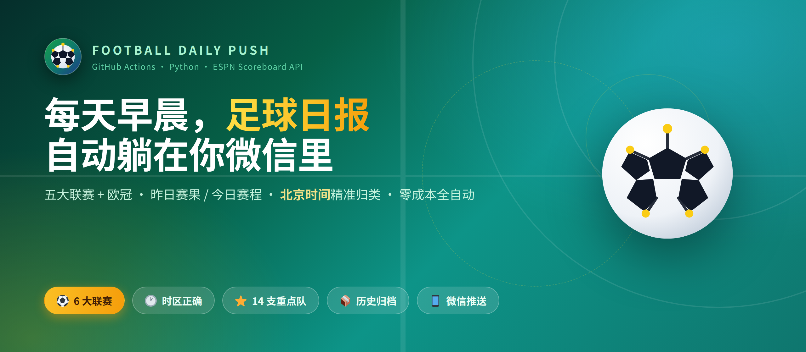
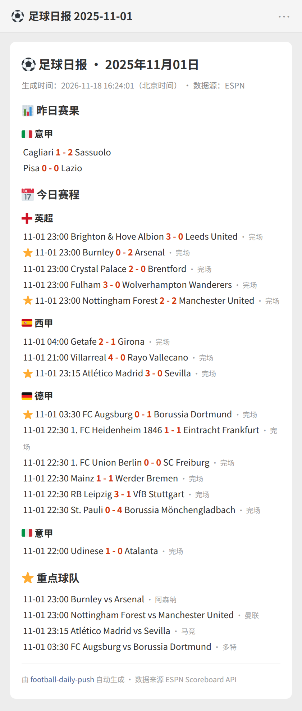

<div align="center">



<p>
  <a href="https://github.com/Erichestein0702/football-daily-push/actions/workflows/daily_push.yml"></a>
  <a href="https://github.com/Erichestein0702/football-daily-push/stargazers"></a>
  <a href="https://github.com/Erichestein0702/football-daily-push/network/members"></a>
  <a href="https://github.com/Erichestein0702/football-daily-push/issues"></a>
  <a href="https://github.com/Erichestein0702/football-daily-push/commits/main"></a>
  <a href="LICENSE"></a>
</p>

<p>
  
  
  
  
  
</p>

<h3>五大联赛 + 欧冠 · 昨日赛果 / 今日赛程 · 北京时间精准归类 · 零成本全自动</h3>

<p>
  <a href="https://github.com/Erichestein0702/football-daily-push"><b>快速开始</b></a> ·
  <a href="#-效果预览"><b>效果预览</b></a> ·
  <a href="#-它能做什么"><b>功能特性</b></a> ·
  <a href="#-五分钟部署到你的微信"><b>部署</b></a> ·
  <a href="#-实现要点"><b>技术细节</b></a> ·
  <a href="#-常见问题"><b>FAQ</b></a>
</p>

</div>

---

## 📸 效果预览

<div align="center">
  
</div>

<div align="center"><sub>← 真实的微信推送截图 · 由 <code>fetch_football.py</code> 自动生成</sub></div>

<br>

日报实际输出长这样：

```markdown
# ⚽ 足球日报 · 2025年11月01日

> 生成时间：2025-11-01 08:00:03（北京时间） · 数据源：ESPN

## 📊 昨日赛果

### 🇪🇸 西甲
- ⭐ Atlético Madrid **3 - 0** Sevilla  <sub>· 马竞</sub>

## 📅 今日赛程

### 🏴󠁧󠁢󠁥󠁮󠁧󠁿 英超
- ⭐ 11-01 23:00 Nottingham Forest **2 - 2** Manchester United  <sub>· 完场</sub>
- 11-01 23:00 Crystal Palace **2 - 0** Brentford  <sub>· 完场</sub>

## ⭐ 重点球队
- 11-01 23:00 Nottingham Forest vs Manchester United  <sub>· 曼联</sub>
```

---

## 🎯 它能做什么

每天早上 8:00（北京时间），GitHub Actions 自动完成这条流水线：

```
ESPN Scoreboard API
        │
        ├─▶ 抓取 6 大联赛 × 4 个 UTC 日期桶（并发）
        │      └─ 按北京时间重新归类 · 昨日赛果 + 今日赛程
        │
        ├─▶ 生成 football_daily.md  ──▶ 推送到微信（PushPlus）
        │
        └─▶ 生成 football_data.json ──▶ 提交回仓库归档
```

### 覆盖的联赛

| 联赛 | ESPN 联赛 ID | 标识 |
|:--|:--|:--|
| 英超 Premier League | `eng.1` | 🏴󠁧󠁢󠁥󠁮󠁧󠁿 |
| 西甲 La Liga | `esp.1` | 🇪🇸 |
| 德甲 Bundesliga | `ger.1` | 🇩🇪 |
| 意甲 Serie A | `ita.1` | 🇮🇹 |
| 法甲 Ligue 1 | `fra.1` | 🇫🇷 |
| 欧冠 UEFA Champions League | `uefa.champions` | 🏆 |

### 核心特性

| | 特性 | 说明 |
|:--|:--|:--|
| 🕐 | **时区正确** | ESPN 按 UTC 日期分桶，日报严格按**北京时间**归类。跨天赛事（UTC 20:00 → 北京次日 04:00）不会错位 |
| ⚡ | **并发抓取** | 6 个联赛 × 4 个 UTC 桶并行请求，整体耗时数秒 |
| 🛡️ | **容错重试** | 内置指数退避重试（3 次 / 退避因子 1.0），单个联赛失败不影响其余联赛 |
| 🔍 | **错误可见** | 抓取失败会在日报顶部以警示块列出，区分「今天没比赛」与「接口挂了」 |
| ⭐ | **重点球队** | 曼联、曼城、利物浦、阿森纳、切尔西、热刺、巴萨、皇马、马竞、拜仁、多特、国米、米兰、尤文 **14 支**自动标记 |
| 🔤 | **中文队名** | 命中重点球队时附带中文简称（如「曼联」「巴萨」） |
| 📦 | **历史归档** | 每日日报自动提交回仓库，可回溯任意一天 |
| 🔐 | **密钥安全** | 微信推送 Token 仅存于 GitHub Secrets，从不写入仓库或提交历史 |

---

## 🚀 五分钟部署到你的微信

### 方式一：Fork + 一键启用（推荐）

1. **Fork** 本仓库到你的账号
2. 打开 [pushplus.plus](https://www.pushplus.plus)，微信扫码登录，复制个人中心的 **Token**
3. 进入你 Fork 后的仓库 **Settings → Secrets and variables → Actions → New repository secret**
   - Name：`PUSHPLUS_TOKEN`
   - Value：粘贴上一步的 Token
4. 进入 **Actions** 页面，手动触发一次 `⚽ 每日足球推送` 验证
5. ✅ 从明天起，每天 08:00（北京时间）日报会自动躺在你微信里

> 工作流已内置 `cron: "0 0 * * *"`（UTC 00:00 = 北京 08:00），Fork 后**无需改任何代码**。
> 唯一的额外权限是 `contents: write`，用于把日报归档回仓库。

### 方式二：本地跑一次看看

```bash
git clone https://github.com/Erichestein0702/football-daily-push.git
cd football-daily-push
python -m pip install -r requirements.txt

python fetch_football.py                     # 抓取今天（北京时间）
python fetch_football.py --date 2025-11-01   # 抓取指定日期
```

运行后生成两个文件：

| 文件 | 说明 |
|:--|:--|
| `football_daily.md` | Markdown 日报（微信推送与提交归档用） |
| `football_data.json` | 结构化数据，含 UTC/北京双时区时间、状态、比分、是否命中重点球队 |

想同时推送到自己的微信：

```bash
export PUSHPLUS_TOKEN=你的PushPlus令牌
python notify_pushplus.py
```

未设置该环境变量时脚本会打印提示并返回 0，不会中断流程。

---

## 🔧 配置项

### 环境变量 / Secret

| 名称 | 必填 | 说明 |
|:--|:--:|:--|
| `PUSHPLUS_TOKEN` | ❌ | [PushPlus](https://www.pushplus.plus) 令牌。未配置时跳过微信推送，日报仍会正常生成归档 |

### 手动触发与回溯

在 Actions 页面触发工作流时可填 `date` 参数，抓取任意历史日期：

```yaml
workflow_dispatch:
  inputs:
    date:
      description: "抓取指定日期（YYYY-MM-DD，北京时间），留空则使用当天"
```

```bash
# 等价于本地执行
python fetch_football.py --date 2025-11-01
```

### 工作流关键配置

| 配置 | 作用 |
|:--|:--|
| `permissions: contents: write` | 允许工作流把日报写回仓库 |
| `fetch-depth: 0` | 保留完整历史，保证 `git pull --rebase` 正常 |
| `concurrency` | 避免定时任务与手动触发并发写入冲突 |
| `cron: "0 0 * * *"` | UTC 00:00 = 北京时间 08:00 |

> 💡 日报正文通过独立的 `notify_pushplus.py` 直接读文件并构造 JSON 请求，
> **不经由 `$GITHUB_OUTPUT` 传递** —— 多行内容写进 `GITHUB_OUTPUT` 会触发
> `Invalid format` 错误使整个工作流失败。

---

## 🧩 项目结构

```
football-daily-push/
├── .github/
│   └── workflows/
│       └── daily_push.yml     # 定时抓取与推送工作流
├── assets/
│   ├── banner.png             # README 横幅
│   ├── logo.svg               # 项目图标
│   └── preview.png            # 微信推送效果预览
├── fetch_football.py          # 核心：数据抓取与日报生成
├── notify_pushplus.py         # 微信（PushPlus）推送
├── requirements.txt           # Python 依赖
├── LICENSE                    # MIT 许可证
├── README.md
└── .gitignore
```

### 核心模块

| 模块 | 职责 |
|:--|:--|
| `FootballFetcher.fetch_day()` | 请求 ESPN Scoreboard 单日桶 |
| `FootballFetcher.fetch_league_window()` | 跨 UTC 桶抓取并按北京时间归类 |
| `FootballFetcher.parse_event()` | 解析 `competitions[0].competitors` 结构，输出标准化 `Match` |
| `collect()` | 多线程并发抓取全部联赛（6 线程） |
| `render_markdown()` | 渲染中文 Markdown 日报 |
| `build_json()` | 构建结构化 JSON 输出 |

---

## 🧭 实现要点

这一节记录了三个**最容易踩坑**的地方，也是本项目与常见「ESPN 抓取脚本」的主要差异。

### 1. 为什么不能用 `event["homeTeam"]`

ESPN Scoreboard API 的真实结构是**嵌套的**：

```
event
└── competitions[0]
    ├── competitors[]      ←  主客队在这里
    │   ├── homeAway: "home" / "away"
    │   ├── score: "2"
    │   ├── winner: true
    │   └── team.displayName: "Manchester United"
    └── status.type.name: "STATUS_FULL_TIME"
```

顶层事件只有 `id / uid / date / name / shortName / season / competitions / status / venue / links`。
直接读 `event["homeTeam"]` 或 `event["lastEvent"]` 只会拿到 `None`，
导致**所有赛事被静默过滤，日报恒为空** —— 而且**不报任何错**，最难排查的那种 bug。

### 2. 时区为什么要跨桶

ESPN 的 `dates=YYYYMMDD` 按 **UTC** 分桶，而欧洲赛事集中在 UTC 12:00–21:00，
换算成北京时间后常落在**次日**。

北京时间日期 D 的赛事，其 UTC 时刻落在 `[D-1 16:00Z, D 15:59Z]`，即分属 UTC 的 **D-1 与 D 两桶**。
而日报需要同时呈现「昨日赛果」和「今日赛程」，目标窗口是 `[D-1, D]`，
再各自向外扩一天，本项目实际抓取 **D-2 / D-1 / D / D+1 共 4 个 UTC 桶**（6 联赛合计 24 次请求），
最后用 `kickoff_utc.astimezone(BJT).date()` 重新归类，确保「今天」在北京时间口径下准确无误。

> **实测（2025-11-01 当天）**：英超 `Nottingham Forest 2-2 Manchester United` 的 UTC 时间为
> `2025-11-01T15:00Z`，是同一天；而西甲 `Getafe 2-1 Girona` 的 UTC 时间为
> `2025-10-31T20:00Z`（北京 11-01 04:00），**落在了 `dates=20251031` 桶里**。
> 若只查 `dates=20251101`，这场西甲就会被整场漏掉 —— 这正是必须跨桶的原因。

### 3. 重点球队匹配为什么不能简单 `in`

ESPN 队名带变音符与前后缀差异（`Atlético Madrid` vs `Atletico Madrid`、
`Internazionale` vs `Inter Milan`、`Tottenham Hotspur` vs `Tottenham`）。
直接字符串包含判断会漏配或误配，故采用**小写 + 去变音符 + 去 FC/AC/SS 等前后缀**的规范化匹配，
再叠加别名表兜底。

---

## ❓ 常见问题

<details>
<summary><b>Q：日报显示「今日无赛事安排」，是脚本坏了吗？</b></summary>

不是。足球联赛存在**国际比赛日休赛期**，且各联赛赛程不同，
休赛期间本就没有比赛。可在 [ESPN Scoreboard](https://site.api.espn.com/apis/site/v2/sports/soccer/eng.1/scoreboard)
直接核对。日报顶部若出现 ⚠️ 警示块，才代表抓取异常。
</details>

<details>
<summary><b>Q：微信没收到推送？</b></summary>

1. 确认 `PUSHPLUS_TOKEN` secret 已配置（Settings → Secrets and variables → Actions）
2. 手动触发工作流，在日志中查看 `Push to WeChat via PushPlus` 步骤输出
3. 确认 PushPlus 令牌未过期
</details>

<details>
<summary><b>Q：工作流提交失败？</b></summary>

已配置 `git pull --rebase origin main` 处理并发冲突；
若仍失败，通常是 `permissions` 缺少 `contents: write`（本仓库已内置）。
</details>

<details>
<summary><b>Q：可以改成其他时间推送吗？</b></summary>

修改 [`.github/workflows/daily_push.yml`](.github/workflows/daily_push.yml) 中的 `cron`。
注意 cron 使用 **UTC** 时间，北京时间 = UTC + 8。
例如北京时间 07:00 → `cron: "0 23 * * *"`。
</details>

<details>
<summary><b>Q：能加更多联赛吗？</b></summary>

可以。在 `fetch_football.py` 的 `LEAGUES` 列表里加一行即可：

```python
{"id": "ned.1", "name": "荷甲", "en": "Eredivisie", "flag": "🇳🇱"},
```

联赛 ID 可从 [ESPN Scoreboard](https://site.api.espn.com/apis/site/v2/sports/soccer) 的路径中获取，
如 `eng.1` = 英超、`esp.1` = 西甲、`por.1` = 葡超。
</details>

<details>
<summary><b>Q：想改推送时间 / 加自己的球队？</b></summary>

- **推送时间**：改工作流的 `cron`（记得 UTC）
- **重点球队**：改 `fetch_football.py` 里的 `HIGHLIGHT_TEAMS` 字典，`"英文队名": "中文简称"`
</details>

---

## 🤝 参与贡献

欢迎任何形式的贡献 —— 报 bug、加联赛、改文案、加功能都算。

1. Fork 本仓库
2. 新建分支：`git checkout -b feature/your-feature`
3. 提交改动：`git commit -m "feat: 你的改动描述"`
4. 推送并发起 Pull Request

**本地验证**：改动 `fetch_football.py` 后跑一次，确认产出正常：

```bash
python fetch_football.py --date 2025-11-01 && cat football_daily.md
```

遇到问题请开 [Issue](https://github.com/Erichestein0702/football-daily-push/issues)，描述里附上：
操作系统、Python 版本、完整报错输出。

---

## 📄 许可证

[MIT](LICENSE) © Erichestein0702

数据来源：[ESPN Scoreboard API](https://site.api.espn.com/apis/site/v2/sports/soccer)，仅供个人学习与非商业用途。

---

<div align="center">
  <sub>用 ⚽ 和一点点 Python 驱动 · 由 GitHub Actions 自动运行</sub>
</div>
